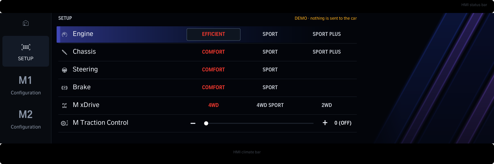

# M Setup (draft)

The iDrive 8 M Setup page as a renderer app, with **dummy switches**: Engine, Chassis, Steering, Brake, M xDrive
(4WD / 4WD Sport / 2WD) and M Traction Control (0 = off ... 10), on the SETUP, M1 and M2 pages. A tap only changes
what the screen shows and is kept in the app's `data/msetup.json`. **Nothing is sent to the car.**

- `layout.js` builds the screen (`renderer/screens.json`): rows, columns, hit boxes, the focus bar and the light bands.
- `src/main.js` the app: dummy state per page, the focus bar on the row last touched; `src/rows.js` the rows and pages.
- `runtime/` the renderer runtime and `pkg/` the manifest / permissions, as in `iteriodev_tailscale` 1.0.4 (no
  diagnostic link).
- `node drafts/iteriodev_msetup/build.js` writes `apps/iteriodev_msetup/` (package, `app.json`, icon) and `preview.png`.

Next: capture what the stock M Setup page sends (SOME/IP, parked) and wire the rows to it one at a time. M xDrive 2WD
can reuse the xDrive-off job (`2E DB E1 00`, stationary in P) where the car's DSC variant is known to take it.
